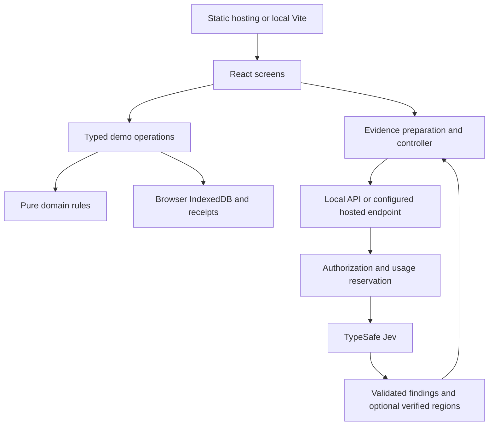

# Architecture

[Documentation index](README.md) · [Development](development.md)

RIFD has two distinct data paths. Financing records and files stay in the browser. An explicit AI check can send selected pages and relevant declarations to a server-side Jev workflow.

## Responsibilities

| Module | Owns |
| --- | --- |
| `packages/rifd-domain` | Validation, product/review rules, correction dependencies and whole-YER repayment calculations. |
| `src/demo` | Role-filtered reads, sessions, file preparation, browser transactions, revisions and operation receipts. Operations, seed data, documents and saved demonstrations live in subfolders. |
| `src/ui`, `src/routes` | Presentation, navigation, unfinished input, dialogs and feedback. Feature folders group screens, copy and helpers; `src/ui/styles` owns CSS. |
| `src/evidence-assistance` | Source preparation, fixed task definitions, findings and retained-result lifecycle. `preparation` renders sources; `analysis` interprets and retains results. |
| `src/live-assistance` | Client/server contracts, local transport, admission, provider integration and usage accounting. `client` and `server` keep browser and Node-only code apart. |
| `functions` | The separately deployed hosted evidence endpoint. |

Screens call complete typed operations rather than constructing database patches. Domain helpers have no browser storage, timers or navigation.

## Saving, publishing and reviewing

Draft data, private correction work and the submitted snapshot are separate. Preparing a file does not save it. Saving a correction does not publish it to the reviewer. Resubmission publishes all required meaningful changes together.

Submission, resubmission, final decisions and reset use transactions with complete effects. Expected revisions reject stale writes. Actor-scoped receipts let the interface inspect an uncertain operation without duplicating it. Approval freezes the terms and repayment illustration with its decision, history and notification.

Applicants see their own data and public history. Reviewers see submitted records, including colleague assignments, but writes require the current assignment and permitted status. Applicant analysis and private corrections are excluded from staff projections. Public print excludes internal notes and review checks. These permissions simulate a product workflow in visitor-controlled storage; they are not production banking security.

The [journey guide](user-flow.md) shows statuses, correction publication and recovery.

## Browser storage and recovery

Committed financing data and language are shared by tabs at the same origin/profile. Sessions are tab-local. Change notifications refresh clean views; views with unfinished work retain it for explicit inspection. Recovery does not silently replay writes.

Startup validates the dataset, file references/hashes and required resources before exposing protected work. Errors preserve existing data and offer retry. A confirmed reset replaces the dataset and invalidates old sessions and pending work across tabs. Already-ready work can continue offline; a fresh offline launch is outside the supported contract. There is no service worker or server write queue.

## Evidence preparation and results

`Demo.createEvidenceAssistance` binds analysis to authorized source bytes, relevant declarations, page selection and the current application/correction/reviewer context. Completion checks those dependencies again. Relevant edits, replacement, sign-out or reset prevent late findings from being published as current.

Workers prepare complete PNG/JPEG images or selected original PDF pages. Analysis accepts at most four selected pages from a PDF of at most 100 original pages. Ordinary source viewing remains independent of analysis limits. PDF.js and its worker/resources are pinned together; install/dev/build copy resources into ignored `public/pdfjs`.

Code combines typed Jev answers with explicit display rules. Complete usable coverage is required for whole-source agreement or absence. Partial checks remain scoped. Optional bound verification and source/crop reconstruction govern whether a named region can be drawn. Missing or rejected geometry leaves ordinary source navigation available. The compact panel keeps details collapsed, and field inspection opens an overlay dialog.

The assistance result never changes financing fields, accepts a document or records a decision. Independent document controls let visitors inspect and prepare another slot while one slot is checking. Reviewer assessment still requires explicit source inspection.

## Retention

The separate `rifd-evidence-analysis` IndexedDB database keeps one applicable completed run per context, with its original seven-day expiry and provenance. Saving matching source/context can retain an otherwise temporary result. Changed dependencies make findings stale. Clearing a run fences late completions; language changes and reopening never restart inference.

Web Locks coordinate financing commits/reset and analysis retention. Without them, assistance remains temporary. Corrupt or incompatible analysis does not prevent financing reads. Reset and expiry cleanup remove results outside their valid dataset/lifetime.

## Local and hosted inference

`pnpm dev:jev` starts a loopback-only local API and the app on port 5174. Signed local sessions, exact-origin checks, fixed requests and durable SQLite admission state protect the local endpoint. The provider key stays server-side. [Development](development.md#local-jev-inference) documents key setup, request allowances and restart behavior.

Hosted access uses a separate Cloud Function and its own identity, App Check and transactional admission controls. The hosted provider is bound and admission was enabled for the [18 October release](releases/2026-10-18.md). Building the app or running the local mode does not change that admission state.

## Presentation and delivery

TanStack Start prerenders a neutral startup shell. Static hosting serves `dist/client` and uses `/_shell.html` for application routes; required UI routes need no runtime Start server. The evidence endpoint is a separate server capability.

The Arabic-first interface shares components between RTL and LTR. Tailwind compiles locally, with Guided A tokens and local Noto fonts. [Styling conventions](development.md#styling) describe logical spacing, source scanning and breakpoints. [Testing](testing.md) distinguishes automated behavior checks from dated manual, performance and release evidence.
