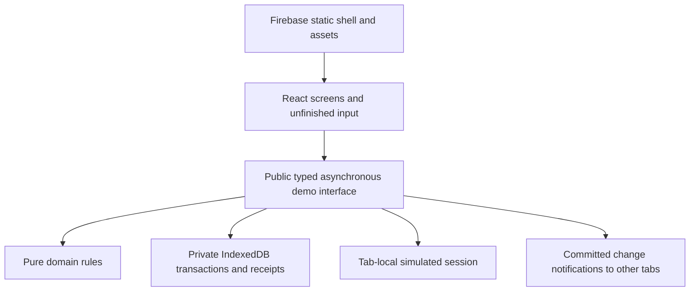

# RIFD architecture

The browser runs the whole demo. Firebase Hosting serves `dist/client` with `/_shell.html` as its fallback. TanStack Start prerenders a neutral Arabic startup shell; browser-only initialization starts after mounting. Required routes need no runtime Start server. The [implementation architecture](implementation/architecture.md) documents operation types, revisions, seed fields and extension rules in detail.

`packages/rifd-domain` owns validation, normalization, transitions, correction dependencies, decision prerequisites and whole-YER arithmetic. It accepts explicit dates and product rules; it does not access UI, storage, timers or navigation. Its packaged guidance follows [the maintainer workflow](implementation/agent-skills.md).

`src/demo` exposes role-filtered reads and complete typed operations. It owns access checks, assignment, sessions, deterministic delays/failures, preparation, durable file bytes, versions and idempotent receipts. One transaction publishes all effects of submission, correction resubmission, a final decision or reset. Expected dataset/record/round revisions prevent stale writes. The primary accepted integration seam exercises this public interface against real IndexedDB. Screens invoke the same interface; they do not assemble storage patches.

React screens own unfinished text, selections, dialogs and accessible feedback. Saved Draft data, private correction workspaces and submitted snapshots are separate. A prepared file becomes durable only through Save or publication. Staff reads exclude private correction work; applicant reads/print exclude internal notes, checks and activity. These are demo permissions in a visitor-controlled browser, not a security boundary against that visitor.

Committed data and language are shared within an origin/profile. Sessions are tab-local. Change broadcasts refresh clean screens; dirty screens retain input and demand inspection. Recovery never silently retries a write. Startup validates schema, references, hashes and the required local sample catalog before Ready. Failure preserves data. Reset replaces the whole dataset atomically and invalidates prior tab work. See the [state/role/recovery sketch](user-flow.md).

Tailwind CSS 4.3.3 compiles through its pinned Vite plugin. `src/ui/styles.css` declares Guided A tokens with `@theme`, local Noto WOFF2 fonts and explicit base styles. Source detection includes production `src` only. Preflight is omitted. Logical utilities support RTL/LTR, with custom compact/narrow boundaries at 1199/767px. The [styling contract](../README.md#styling), [migration comparison](implementation/tailwind-v4.md) and [measured release](implementation/22-evidence.md#final-results) document preserved appearance and generated asset sizes.

The [acceptance checklist](acceptance/README.md) separates automated behavior, ordinary-browser manual work, print inspection, performance and hosted checks. Browser-only persistence, no real authentication or payment processing, and fresh-offline launch remain explicit limits.

Draft, private correction and submitted identity and business assistance use `Demo.createEvidenceAssistance`. The handle owns an
explicit inspect/run/cancel/refresh/clear lifecycle and retained results. Authorized reads bind
actual source bytes, relevant declarations and authority/dependency generations.
Completion rechecks those dependencies. Replacement, relevant edits, sign-out,
reset and view disposal cannot publish late findings. Language changes do not run
analysis. Assistance never writes financing data.

Correction inputs bind the current workspace's round identifier. The same task
context includes the actual reviewer-written target reasons, permitted fields and
document slots, and the initial submission month for later financial tasks.
Every question depends on that shared context. Document-only correction targets
keep the name read-only in operations and presentation. Matching ordinary Save
can retain a temporary result without restarting its run. Resubmission closes
that round's analysis authority and publishes only the correction response.
Staff reads, public print, notifications and review activity exclude applicant
analysis before and after publication. Correction validation and deterministic
financing calculations continue through their existing operations.

Reviewers use `find-supporting-evidence` with the same task definitions and
lifecycle. The selector reads the authorized submitted snapshot even while an
applicant saves private corrections. Reviewer inputs cannot override declarations
or supply prepared files. Staff reading does not require assignment and grants no
write permission. Reviewer records remain separate from applicant records.
Their dependency key includes the existing inspection context, so publication and
assignment transitions invalidate findings, including reassignment away and back.
Unrelated notes preserve findings after a fresh authorized read.

The shared assistance panel places the submitted source, findings and existing
assessment controls in three columns on desktop and stacks them on smaller
screens. Ordinary PDF inspection has explicit page navigation, open and download
routes independent of analysis coverage and limits. Opening a source or receiving
findings never confirms inspection. Assessment writes still require the current
inspection confirmation or the explained unable-to-open replacement exception.

`src/evidence-assistance` separates the shared contracts, fixed question/display
policy, cancellable browser preparation and controller. Preparation uses one
terminable worker for a complete PNG/JPEG or proven one-page PDF. PDF.js 5.4.296,
its worker and resources are pinned together. Install/dev/build copy the matching
resources into ignored `public/pdfjs`; production builds retain them as static
assets. Source/raster hashes, orientation, padding and transforms accompany each
result. The pinned JPEG decoder rejects truncated scans that browser decoding
would repair silently. Incomplete, encrypted, oversized or multipage sources remain available
through ordinary inspection but cannot produce one-page findings.

Shared target definitions identify business name, address and operating-since
month for separate presence and support findings. Invalid or missing declarations
skip only their comparisons. Existing domain validation determines applicability;
operating-history arithmetic and eligibility stay in the domain rules. Every
model-visible declaration participates in each question's dependency manifest.
Business checks share correction permissions, reviewer source selection and
retention without depending on unrelated applicant fields or staff notes.
The current one-page limit also applies to business evidence; multipage support
and automatic highlights remain separate implementation tickets.

The controller reserves the shape of a two-stage plan for later bound verification;
this slice evaluates only the combined page/declaration stage. It retains native
answers, distributions, fractional readability, usage and timestamps in provenance.
Ordinary runtime has no provider transport and reports live analysis unavailable.
Only test entry points inject deterministic or fake HTTP transports with dummy
credentials. Service admission, native SDK integration and automatic highlights
belong to subsequent tickets.

Analysis uses the separate version-1 `rifd-evidence-analysis` IndexedDB database
after financing startup validates the current dataset. The financing database
keeps its one-store layout and unchanged logical records. Context records retain
one bounded completed run, its original seven-day expiry, native/mapped answers,
coverage, dependency manifest and versions. Prepared visitor images are never
archived. Restored results retain their dates and say previous live analysis.
Changed dependencies keep explicitly stale scope and provenance while suppressing
current findings. Corrupt or incompatible analysis does not affect financing reads.

Web Locks serialize financing commits/reset with analysis retention. Each context
has a run generation and a separate clear generation. A newer run fences late
completions without discarding another view's completed unsaved result; clear
fences both. Without Web Locks, assistance remains temporary. Unsaved sources and
context become durable only after matching ordinary Save. Failed/cancelled runs
retain the previous result and expiry. Storage failure leaves new findings
temporary and reports that they cannot be recovered after closing.

Reset invalidates local authority before replacing financing data. Cleanup of
old-dataset and expired analysis runs during startup and activation, including
recovery after interrupted cleanup. Public `analysisAvailability()` reports its
status. Cross-tab hints carry dataset identifiers only; each view rereads its own
authorized source/context. Reads never restart inference or replay a server
answer. No live overlays are implemented yet; a later highlight restoration must
reconstruct and verify the recorded raster before drawing anything.
