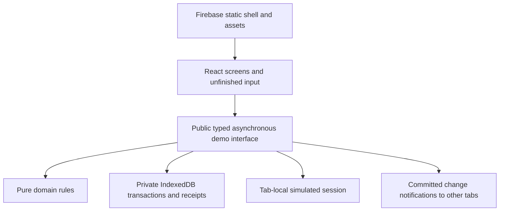

# RIFD architecture

The browser runs the whole demo. Firebase Hosting serves `dist/client` with `/_shell.html` as its fallback. TanStack Start prerenders a neutral Arabic startup shell; browser-only initialization starts after mounting. Required routes need no runtime Start server. The [implementation architecture](implementation/architecture.md) documents operation types, revisions, seed fields and extension rules in detail.

`packages/rifd-domain` owns validation, normalization, transitions, correction dependencies, decision prerequisites and whole-YER arithmetic. It accepts explicit dates and product rules; it does not access UI, storage, timers or navigation. Its packaged guidance follows [the maintainer workflow](implementation/agent-skills.md).

`src/demo` exposes role-filtered reads and complete typed operations. It owns access checks, assignment, sessions, deterministic delays/failures, preparation, durable file bytes, versions and idempotent receipts. One transaction publishes all effects of submission, correction resubmission, a final decision or reset. Expected dataset/record/round revisions prevent stale writes. The primary accepted integration seam exercises this public interface against real IndexedDB. Screens invoke the same interface; they do not assemble storage patches.

React screens own unfinished text, selections, dialogs and accessible feedback. Saved Draft data, private correction workspaces and submitted snapshots are separate. A prepared file becomes durable only through Save or publication. Staff reads exclude private correction work; applicant reads/print exclude internal notes, checks and activity. These are demo permissions in a visitor-controlled browser, not a security boundary against that visitor.

Committed data and language are shared within an origin/profile. Sessions are tab-local. Change broadcasts refresh clean screens; dirty screens retain input and demand inspection. Recovery never silently retries a write. Startup validates schema, references, hashes and the required local sample catalog before Ready. Failure preserves data. Reset replaces the whole dataset atomically and invalidates prior tab work. See the [state/role/recovery sketch](user-flow.md).

Tailwind CSS 4.3.3 compiles through its pinned Vite plugin. `src/ui/styles.css` declares Guided A tokens with `@theme`, local Noto WOFF2 fonts and explicit base styles. Source detection includes production `src` only. Preflight is omitted. Logical utilities support RTL/LTR, with custom compact/narrow boundaries at 1199/767px. The [styling contract](../README.md#styling), [migration comparison](implementation/tailwind-v4.md) and [measured release](implementation/22-evidence.md#final-results) document preserved appearance and generated asset sizes.

The [acceptance checklist](acceptance/README.md) separates automated behavior, ordinary-browser manual work, print inspection, performance and hosted checks. Browser-only persistence, no real authentication or payment processing, and fresh-offline launch remain explicit limits.

Draft identity assistance uses `Demo.createEvidenceAssistance`. The handle owns an
explicit inspect/run/cancel lifecycle and temporary results. Authorized reads bind
actual source bytes, declared-name context and authority/dependency generations.
Completion rechecks those dependencies. Replacement, relevant edits, sign-out,
reset and view disposal cannot publish late findings. Language changes do not run
analysis. Assistance never writes financing data.

`src/evidence-assistance` separates the shared contracts, fixed question/display
policy, cancellable browser preparation and controller. Preparation uses one
terminable worker for a complete PNG/JPEG or proven one-page PDF. PDF.js 5.4.296,
its worker and resources are pinned together. Install/dev/build copy the matching
resources into ignored `public/pdfjs`; production builds retain them as static
assets. Source/raster hashes, orientation, padding and transforms accompany each
result. The pinned JPEG decoder rejects truncated scans that browser decoding
would repair silently. Incomplete, encrypted, oversized or multipage sources remain available
through ordinary inspection but cannot produce one-page findings.

The controller reserves the shape of a two-stage plan for later bound verification;
this slice evaluates only the combined page/declaration stage. It retains native
answers, distributions, fractional readability, usage and timestamps in provenance.
Ordinary runtime has no provider transport and reports live analysis unavailable.
Only test entry points inject deterministic or fake HTTP transports with dummy
credentials. Separate analysis storage, service admission, native SDK integration
and automatic highlights belong to subsequent tickets.
