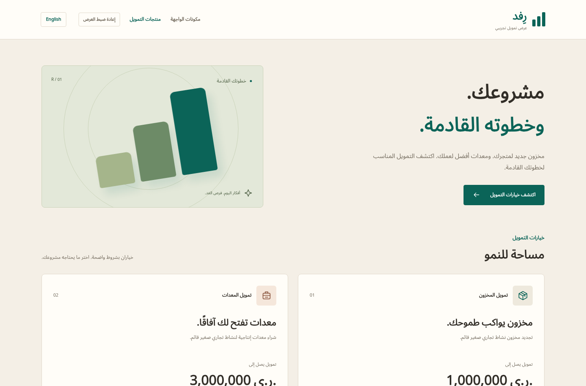

# قصة رِفد

[فهرس التوثيق](README.md) · [جرّب الموقع](https://rifd-portfolio-mdnb.web.app) · [شاهد الجولة](demo/rifd-demo.mp4)

رِفد تجربة لرحلة طلب التمويل من جهتي المتقدم والمراجع. بدأت الفكرة بنموذج طلب، ثم اتسعت لتشمل حفظ العمل، والمستندات، والتصحيحات، والقرار، والتعافي عندما لا تسير الخطوات كما يتوقع المستخدم.

## مشروع بُني عبر توجيه الذكاء الاصطناعي

بنيتُ المشروع بالكامل باستخدام الذكاء الاصطناعي. كان دوري تحديد المطلوب، وتجربة النتائج، وشرح المشكلات وطلب التعديلات. تولّى الذكاء الاصطناعي كتابة الشفرة وتعديلها بتوجيهاتي.

شملت التعديلات طريقة اختيار الملفات، ووضوح الحفظ، وتجميع المستندات، وتبسيط نتائج الفحص. عندما كان موضع الحقل يظهر أسفل الأزرار وقد لا يراه المستخدم، أصبح يُفتح في نافذة فوق الصفحة.

## أن يعرف المستخدم ما الذي حدث

وجود اسم الملف لا يعني حفظه. وحفظ استجابة التصحيحات لا يعني إرسالها للمراجع. ركزت الواجهة على هذه الفروق لأن الخلط بينها قد يجعل المتقدم يعتقد أنه أنهى عمله بينما لا يزال في مسودة خاصة.

في المثال الجاهز لهدى، المبلغ المقدّم هو 600,000 ريال. يمكنها حفظ استجابة بمبلغ 450,000 وخطة شراء بديلة دون تغيير ما يراه المراجع. إعادة الإرسال هي التي تنشر التغييرات معًا، ثم يعيد المراجع الفحوص المتأثرة.

## العربية جزء من التصميم

تبدأ التجربة بالعربية واتجاه اليمين إلى اليسار، مع إمكانية التحويل إلى الإنجليزية أثناء العمل. تشترك اللغتان في المكونات نفسها، وتستخدم الواجهة خطوط Noto المحلية وألوانًا هادئة ومسارات واضحة للطلب والمراجعة. تتحول قائمة الموظف إلى بطاقات في المساحات الضيقة.

## كيف يساعد Jev؟

أُضيفت مساعدة اختيارية لفحص المستندات ومقارنتها بالبيانات التي أدخلها المستخدم. يعرض التطبيق ملاحظات مختصرة، ويتيح فتح المصدر وموضع الحقل، ويُبقي التفاصيل الإضافية لمن يحتاجها.

يبقى فحص النموذج منفصلًا عن قبول المستند والقرار النهائي. إذا لم يتحقق التطبيق من موضع الحقل فلا يرسم تحديدًا مضللًا. وفي التشغيل المحلي الفعلي، أعادت حالة الهوية الإنجليزية نتيجة مكتملة، بينما أعادت العربية نتيجة جزئية. حُجب التحديد في الحالتين. هذه نتيجة مفيدة لفهم حدود التجربة، وليست مقياسًا عامًا للدقة.

[دليل الذكاء الاصطناعي](ai-features.md) يشرح الفرق بين الفحص الفعلي والنتيجة السابقة والمثال المحفوظ. الفيديو يعرض هذه الفروق دون إخفاء الملاحظات غير الحاسمة.

## عندما تتغير البيانات أثناء العمل

يمكن نقل الطلب إلى مراجع آخر بينما شاشة القرار ما زالت مفتوحة. يرفض التطبيق القرار المبني على النسخة القديمة، ويحتفظ بالسبب غير المرسل لفحصه. يحتاج المراجع تحميل النسخة الحالية وفهمها ثم تأكيد إجراء جديد.

تخدم معاملات التخزين وإيصالات العمليات الهدف نفسه. إذا لم يرَ المستخدم نتيجة عملية بسبب انقطاع أو انتهاء جلسة، يمكن فحص ما إذا كانت حُفظت بدل تكرارها دون معرفة.

## ما الذي تثبته الاختبارات؟

تغطي الاختبارات قواعد الطلب، والتخزين الفعلي في المتصفح، والرحلات المرئية والتعافي. تحتفظ سجلات الإصدارات بفحوص الاتجاهين والطباعة والأداء والسيناريوهات التي فشلت ثم أُعيد فحصها.

الأرقام القديمة وقياسات الأداء تخص نسخًا وظروفًا محددة. لا تثبت دقة Jev على جميع المستندات أو تجربة كل جهاز. [دليل الاختبارات](testing.md) يوضح طريقة التحقق، و[السجل التاريخي](history.md) يقود إلى الأدلة الأصلية.

## حدود التجربة

بيانات التمويل والمستندات محفوظة في متصفح الزائر، ولا تتزامن بين الأجهزة. الهويات والصلاحيات والقرارات افتراضية. الفحص الفعلي يرسل الصفحات والبيانات اللازمة إلى TypeSafe عند طلب المستخدم، ويحتاج مفتاحًا وخدمة متاحة.

لا يقدم رِفد تمويلًا حقيقيًا أو توثيق هوية أو تحصيل مدفوعات. تحويله إلى خدمة حقيقية يتطلب تصميمًا مستقلًا للتخزين المركزي والمصادقة والصلاحيات وحماية البيانات.

