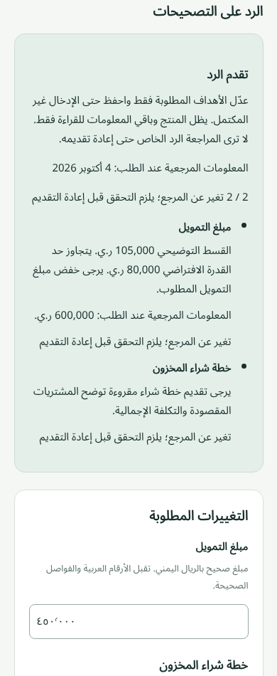
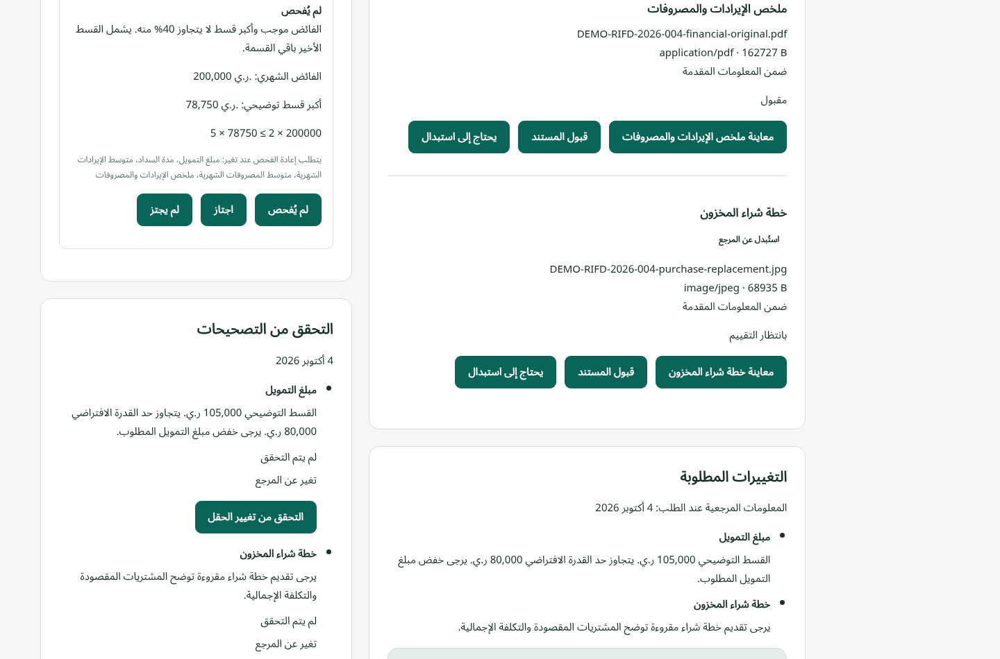
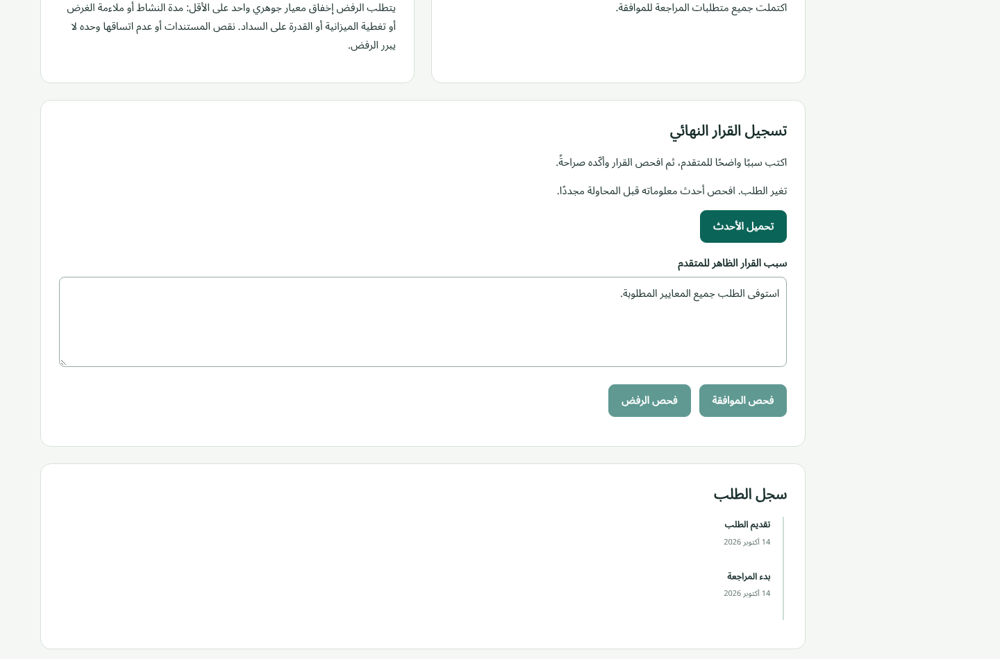
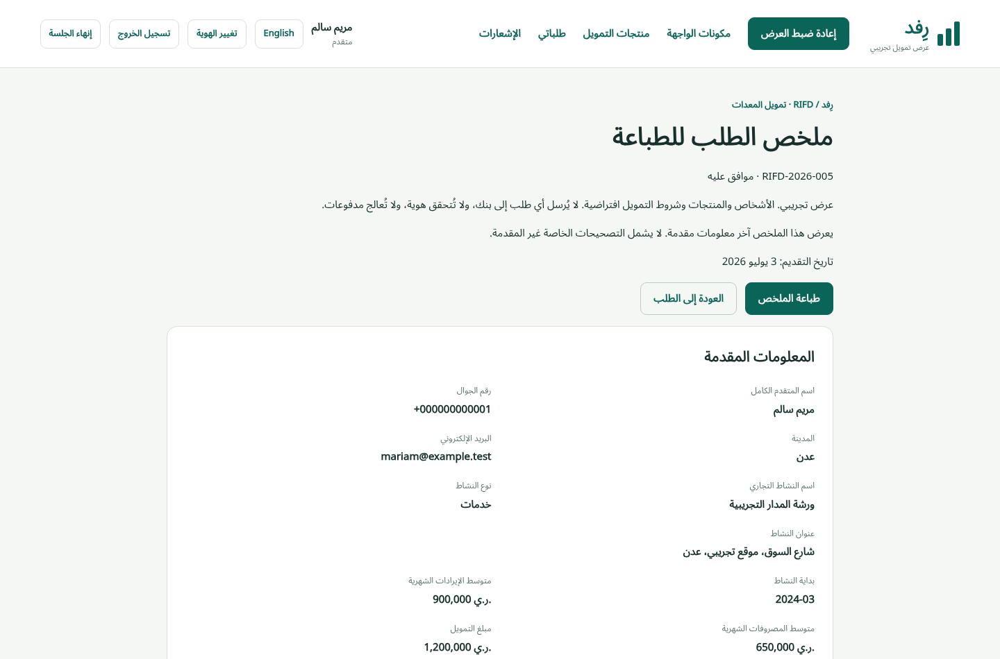

# RIFD: a financing application and review demo

[Try the live demo](https://rifd-portfolio-mdnb.web.app), [watch the 4:30 film](demo/rifd-demo.mp4), or [inspect the public source](https://github.com/mohammed-najib/rifd-financing-demo). The [longer chapter guide](demo-guide.md) reproduces all seven journeys. RIFD uses invented people, products and decisions. It sends no request to a bank, verifies no real identity and processes no payment.

## The problem

An applicant needs to prepare a financing request over several visits and know what has actually been saved or submitted. A reviewer needs to assess the submitted evidence, ask for precise corrections and explain the final decision. The difficult part is preserving those distinctions when a file fails, a session expires or another tab changes the application.

The accepted scope gives equal time to products/application, documents/recovery, tracking/notifications/print, queue/assignment, review/corrections, decisions/repayment and access/sessions/reset. The film reserves 35 seconds for each journey, plus a ten-second introduction and fifteen-second closing. Its [export manifest](demo/film.json) records the measured file duration and embedded chapter boundaries.

## Arabic first, shared production components

Guided A uses a restrained green palette, a step-led applicant form and a denser staff workspace. Arabic starts in RTL; an explicit English switch changes direction while retaining the current work. Local Noto Sans Arabic and Noto Sans cover mixed script, Western display digits, identifiers, filenames and whole-YER values. On wide screens, submitted information sits beside the review controls. Narrow screens stack the same sections and use queue cards.

Tailwind CSS 4.3.3 compiles through `@tailwindcss/vite` 4.3.3 and Vite 8.3.4. Guided A tokens live in `@theme`; logical spacing, exact arbitrary dimensions and custom compact/narrow variants preserve the accepted layout. Preflight is omitted. The [migration comparison](implementation/tailwind-v4.md) and [final layout/print work](implementation/21-evidence.md) retain the visual evidence. The measured release contains 23,929 bytes of compiled CSS, 5,240 gzip, and 134,568 bytes of local WOFF2 fonts. No browser Tailwind runtime or CDN is used.

| Applicant, Arabic at 390 CSS pixels | Reviewer, Arabic at 1440 CSS pixels |
| --- | --- |
|  |  |

These captures come from the actual hosted release while preparing the film. The applicant's private work is distinct from the submitted baseline. Staff can inspect submitted changes only after resubmission.

## Corrections have a publication boundary

Huda's 004 starts with a 600,000 YER submitted amount and a requested replacement plan. Saving a 450,000 response does not alter the reviewer's submitted record. Resubmission publishes the changed amount and readable new plan together, returns directly to Under review and keeps the assignee. Highlighting compares each target against that round's fixed baseline. It resets dependent checks and retains unrelated assessments.

The reviewer then verifies the field and accepts the replacement. A correction round is not an approval. A fresh round retains earlier request/response history. The [resubmission evidence](implementation/13-evidence.md) and [public-interface tests](../tests/browser/resubmission.api.spec.ts) cover publication, identical-content refusal, repeated rounds and dependent rechecks.

## A stale decision must fail

The film prepares Mariam's 001 through normal submission, assignment, four Accepted documents and five Passed checks. While Salma's decision screen stays open, a labelled control assigns the record to Khaled. The attempted approval fails against the newer revision. Load latest preserves the unsent reason read-only, reveals the new assignment and clears confirmation. Salma confirms reclaim, inspects the current application and makes a new confirmation before approval commits.

The film also creates Omar's new Inventory application through the normal five-step form. An August 2026 start does not block submission; it makes the Operating history review criterion fail in October. Salma claims, starts review and records an explained new rejection. The film manifest records its generated reference, separate from historical seed 006. The [uncut take and trace](https://github.com/mohammed-najib/rifd-financing-demo/releases/tag/rifd-delivery-v1) retain the setup omitted by the short edit.

Approval freezes the terms and schedule atomically with the decision, history, notification and receipt. New approvals have only Upcoming entries. Historical 005 has two Completed entries, 144,000 YER completed and 1,152,000 remaining. The browser date never regenerates that snapshot.

## Evidence that can be inspected

The [saved Arabic PDF](implementation/evidence/24/approved-ar.pdf) and [bilingual final print inspection](implementation/evidence/21/print-review.json) cover public reasons and history without internal notes, review checks or private correction work. Both roles use the same public print policy.

The final release measurements used mobile Lighthouse 13.5.0 with simulated Slow 4G and 4x CPU throttling, production static files and three runs per route/language. All 24 runs passed with CLS zero. The [published raw Lighthouse JSON and run binding](implementation/evidence/24/performance/run.json) preserve individual values and source/build hashes.

| Route | Arabic median | English median |
| --- | ---: | ---: |
| Products | 96 | 95 |
| Applicant list | 96 | 96 |
| Staff queue | 94 | 95 |
| Staff review 007 | 99 | 96 |

The final feedback measurements were 24.8/24.5 ms for save, 25.4/28.2 ms for upload, 25.1/28.7 ms for submission and 26.6/26.8 ms for decision, Arabic/English respectively. All met the 100 ms limit. These are input-to-paint upper bounds under the recorded conditions, not a promise for every device.

The [complete acceptance run](implementation/22-evidence.md#final-results) passed 105 domain tests, 11 package-guidance tests, 159 API cases, 564 screen cases and 30 delivery cases before the final storage/render fixes. The final affected rerun passed 165 API cases, 180 screen cases and all 30 delivery cases against the measured source. Twelve expected delivery skips reserve timing APIs for Chrome. Hosted acceptance reconciles 66 preview cases and 45 live cases with explicit unchanged-case rechecks; original failed runs remain visible. The [delivery checklist](acceptance/README.md) links every accepted requirement to the evidence and records the new delivery checks separately.

The slice 24 regression covered all 165 API, 564 screen and 30 required delivery cases. Its original invocation remains failed. One Firefox setup failure passed three unchanged repetitions. Two English sample-layout failures reproduced in isolation and exposed a measurement race: queued entries from before the first sample frame arrived after recording began. The corrected measurement passed all four language/width combinations three times each. Raw entries remain available. Every application source and all eight live static files still match the measured release; only the reviewed test measurement changed. See [the complete validation record](implementation/evidence/24/validation.json).

## Limits and tradeoffs

Data and files live in this origin's browser profile. Other browsers and devices do not share them. Clearing site data, private browsing or browser eviction can remove them. Browser-local transactions and receipts prevent partial writes and duplicate replay through the simulated interface, but local storage inspection can expose or alter demo data. Identity and permission controls are simulations, not production authentication or banking security.

The tested automated engines were installed Chrome 155.0.8059.39, Playwright Firefox 157.0 and WebKit 27.2 on Linux. Ordinary Chrome and Firefox 155.0.1 supplemented them. Responsive claims refer to measured CSS viewports at 360, 390, 768 and 1440px, with documented native 200% zoom checks. The user-assisted screen-reader smoke used Orca 50.2 with ordinary Firefox 155.0.1 and Speech Dispatcher. It covered four named scenes, not complete assistive-technology certification. No physical phone, tablet or branded Safari check is claimed. Ordinary Firefox release smoke completed its checkpoints but its teardown exited with an error; the [release record](implementation/23-evidence.md) keeps that limitation explicit.

Already-ready offline work is supported; a fresh offline launch is outside scope. There is no real lending, conversation channel, second interactive reviewer, withdrawal/reopening or payment service. These boundaries kept attention on saved/submitted/private data, conflicts and recovery. The next real-service version would need server authorization, durable cross-device storage and a separately designed security model.

The [architecture](architecture.md), [state/role sketch](user-flow.md), [seed/control/reset guide](demo-guide.md) and [immutable planning/design/research pointers](acceptance/README.md#decision-and-design-provenance) preserve the decisions behind the implementation. The measured application release is commit `1352c140782168ce9e77773547e35658c19cff45`, served at [the live Firebase site](https://rifd-portfolio-mdnb.web.app) as Hosting version `ea1a7ab0ece6377e`.
