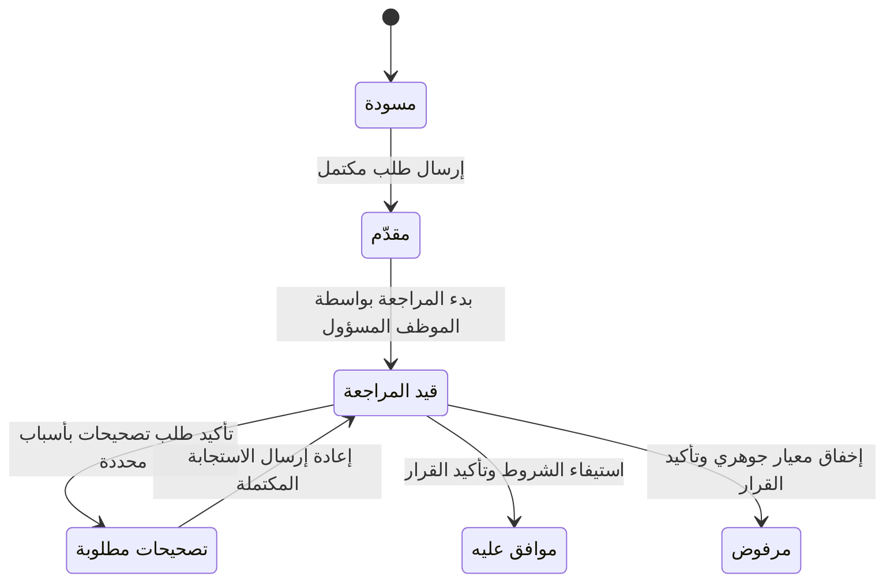
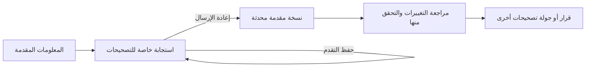

# رحلة الطلب والأدوار

[فهرس التوثيق](README.md) · [دليل التجربة](demo-guide.md)

للطلب حالة، وللمستند تقييم، وللمراجعة موظف مسؤول. تغيير الموظف المسؤول لا يبدأ المراجعة ولا يغيّر حالة الطلب وحده.

## من يستطيع فعل ماذا؟

| الحالة | المتقدم | المراجع |
| --- | --- | --- |
| مسودة | يعدّل ويحفظ العمل غير المكتمل، ثم يرسله عندما يكتمل. | لا يطّلع على المسودة. |
| مقدّم | يقرأ ما أرسله ويتابع الحالة. | يطّلع على الطلب ويستلمه، ثم يبدأ المراجعة بإجراء منفصل. |
| قيد المراجعة | يقرأ المعلومات المقدمة والتاريخ. | الموظف المسؤول يقيّم المستندات والفحوص، ويحفظ الملاحظات أو يطلب تصحيحات. |
| تصحيحات مطلوبة | يعدّل المطلوب فقط ويحفظ استجابته الخاصة قبل إعادة إرسالها. | يقرأ النسخة المقدمة السابقة إلى أن تُنشر الاستجابة. |
| موافق عليه أو مرفوض | يقرأ السبب والتاريخ ويطبع الملخص. تظهر صورة السداد الافتراضية عند الموافقة. | يقرأ القرار النهائي؛ لا يعيد فتح الطلب أو تعديل القرار. |

## الحفظ ليس إرسالًا

اختيار الملف يجهزه. حفظ التقدم يحفظه مع العمل. في التصحيحات، تبقى الاستجابة خاصة حتى يختار المتقدم إعادة الإرسال. عندها تُنشر التغييرات معًا، ويعيد المراجع الفحوص التي تأثرت بها فقط.

الموافقة تحتاج مستندات مقبولة وخمسة فحوص ناجحة والتحقق من التصحيحات المتبقية. الرفض يحتاج إخفاق معيار مراجعة جوهري. كلا القرارين يحتاج سببًا ظاهرًا للمتقدم وتأكيدًا جديدًا.

## أين يدخل الذكاء الاصطناعي؟

فحص Jev مساعدة اختيارية بجانب المستند. لا ينقل الطلب إلى حالة جديدة، ولا يقبل المستند، ولا يملأ الحقول أو يقرر التمويل. يستطيع المتقدم فحص ما يجهزه، ويبحث المراجع في الأدلة المقدمة المسموح له بقراءتها. [شرح الميزة](ai-features.md).

## عند التعارض أو انتهاء الجلسة

إذا تغيّر الطلب أو إسناده أثناء فتحه، يرفض التطبيق الكتابة القديمة ويتيح تحميل الأحدث مع الاحتفاظ بالنص غير المرسل للفحص. أي قرار يحتاج مراجعة النسخة الحالية وتأكيدًا جديدًا.

إذا انتهت الجلسة، تُغطى المعلومات المحمية. الدخول بالهوية نفسها يتيح فحص العمل المسموح واستعادته في التبويب. لا يُعاد تنفيذ الإجراء السابق تلقائيًا. إعادة ضبط العرض تستبدل البيانات في جميع تبويبات العنوان نفسه بعد تأكيد واضح.

للتعريفات الدقيقة بالإنجليزية، راجع [المصطلحات](../GLOSSARY.md).

