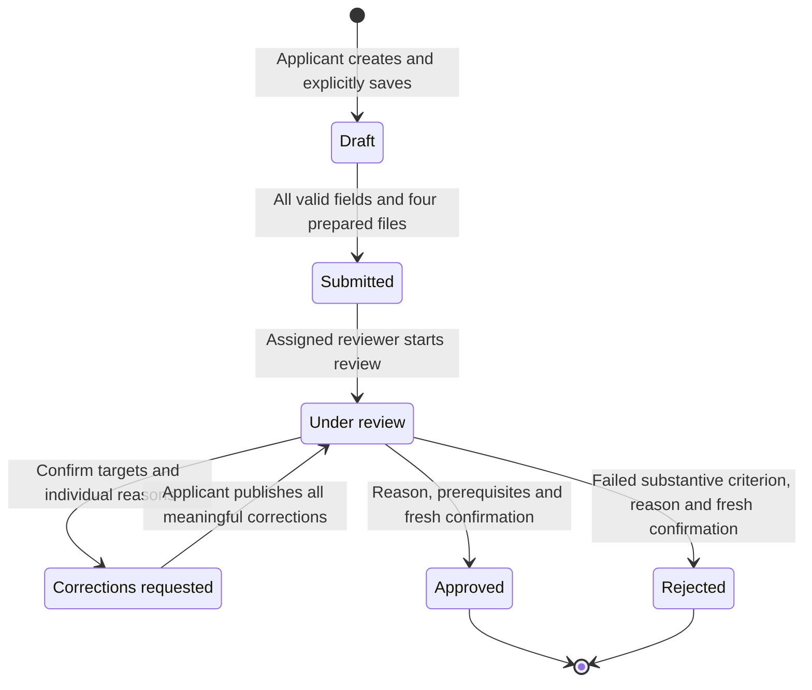
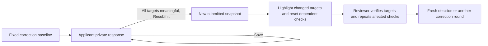
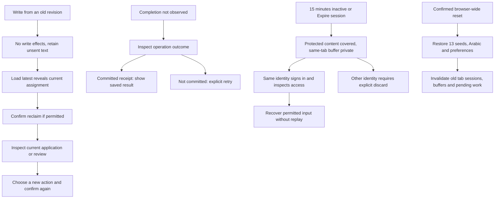

# States, roles and recovery

Application status is separate from assignment, document review status and correction verification. The [glossary](../GLOSSARY.md) defines these terms. The [demo guide](demo-guide.md) names identities, records and controls for each path.

| Boundary | Applicant | Reviewer |
| --- | --- | --- |
| Draft | Owner edits/saves incomplete values and files; explicit submission validates | Cannot read applicant drafts |
| Submitted | Reads submitted information/history, prints | Reads all submitted records; claim/confirmed transfer does not start review |
| Under review | Reads current submitted information | Assigned reviewer assesses documents, five checks, internal notes and correction targets |
| Corrections requested | Edits only current targets; Save stays private; Resubmit publishes atomically | Reads unchanged submitted snapshot and saves authorized notes; no decision or assessments until resubmission |
| Approved / Rejected | Reads reason/history and prints; Approved adds frozen illustration | Reads final record; assigned reviewer can save internal notes; final fields, evidence, checks and assignment stay locked |

Only accepted documents, five Passed checks and verified outstanding targets allow approval. Missing evidence calls for corrections. Rejection requires a failed substantive criterion. Both decisions require an applicant-visible reason and a new explicit confirmation. New approvals freeze entirely Upcoming entries; historical Completed entries stay fixed.

Salma can read colleague assignments, but only the current assignee can write review results. A confirmed transfer preserves status and review work. Unassignment is permitted only before review. Khaled cannot sign in.

A forbidden or missing reference uses a neutral unavailable screen. There is no record-detail flash before access resolves. Startup/storage failures preserve data and offer explicit retry; failed reset preserves the prior dataset. These guarantees concern the simulated interface, not resistance to local storage inspection.
